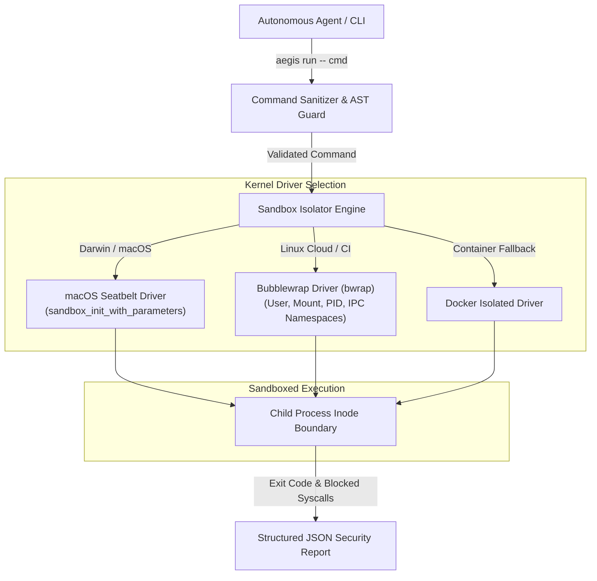

# Architecture Specification: aegis-sandbox

## 1. System Architecture Diagram

---

## 2. Component Blueprint
- **`src/sanitizer.rs`**: Regex and AST-level rule engine inspecting command arguments against exfiltration strings, fork bombs, and root directory traversal.
- **`src/isolator.rs`**: Cross-platform driver abstraction detecting host operating system and configuring the tightest sandbox isolation backend.
- **`src/main.rs`**: CLI entry point parsing command arguments and returning standard POSIX exit codes.
